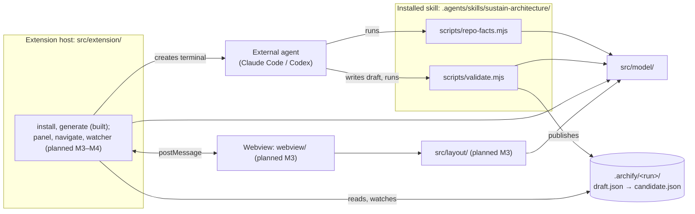
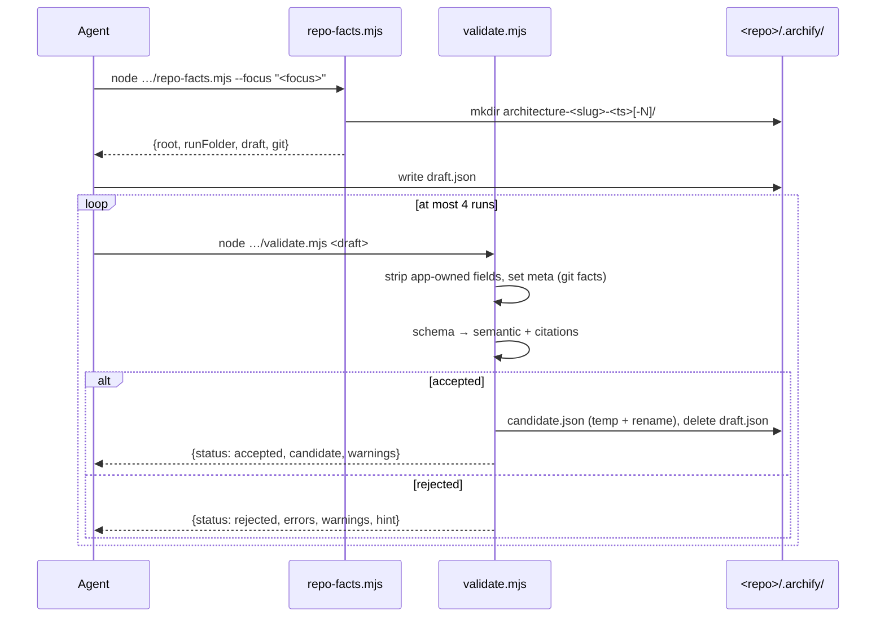

# Sustain architecture

Sustain is a VS Code extension that shows a repository's architecture as an Archify diagram and opens the code cited by each node. Diagrams are produced by an external coding agent (Claude Code or Codex) running the bundled `sustain-architecture` skill, whose scripts validate and publish the diagram; the extension itself never calls an LLM ([ADR 0002](adr/0002-external-coding-agent-generates-diagrams.md)).

> **Build state (M2).** Built: the shared model (`src/model/`), the skill (`skills/sustain-architecture/` plus the scripts built from `src/agent/`), the `Install Agent Skills` and `Generate Architecture` commands, and the build/test harness. Not built yet, and marked *planned* below: layout, viewer and webview (M3), navigation, watching and the test hook (M4).

## Components

## Modules

### `src/model/` (built)

Pure TypeScript shared by the scripts, and later by the extension host and webview. No `vscode` import anywhere.

| File | Responsibility | Node APIs |
|---|---|---|
| `types.ts` | Archify v1 types (`ArchifyDoc`, `Component`, `SourceRef`, …), `Issue {code, pointer, message}`, `stringifyDocument` (2-space JSON + newline), `pointerToken`. Documents stay plain parsed JSON, so unmodelled fields survive rewrites (FR-MOD-01). | none (browser-safe) |
| `schema.ts` | `validateArchitecture(value)`: Ajv draft 2020-12 (`ajv/dist/2020`, `allErrors`, `strict: false`) over the vendored `schemas/*.schema.json`, `$ref`s resolved by `$id` in memory; errors → `Issue` with JSON pointers (FR-MOD-02). | none |
| `checks.ts` | `semanticChecks(doc)`: duplicate IDs, unknown references, missing sources, overlapping/equal boundaries; `boundaryRelation` (FR-VAL-04). | none (browser-safe) |
| `deny.ts` | `isDenied(path)`: citation deny-list, any segment, case-insensitive (FR-VAL-05). | none |
| `citations.ts` | `citationPathOk`, `countLines`, `probeFile(rootReal, path)` (real-path confinement, regular file, ≤ 2 MiB, NUL sniff), `rangeProblem`, `checkCitations(doc, root)` (FR-VAL-05). | `node:fs`, `node:path` |
| `git.ts` | `collectGitFacts(root)` via fixed-argv `git` with `GIT_TERMINAL_PROMPT=0`; `sanitizeOrigin`, `parsePorcelainZ`, `repositoryFromGit` (FR-GIT-01). | `node:child_process`, `node:fs` |
| `runFolder.ts` | `slugify`, `runTimestamp`, `RUN_FOLDER_PATTERN`/`parseRunFolderName`, `createRunFolder` (collision `-N`), `locateDraft`, `publishCandidate` (temp + rename, then delete draft) (FR-RF-01, FR-VAL-06). | `node:fs`, `node:path` |
| `submission.ts` | `applyAppOwnedFields` (step 1, FR-VAL-02) and `checkSubmission(value, app, checkCitations)`: schema, then semantic + injected citation check (FR-VAL-03..06). | none (file access injected) |
| `tolerant.ts`, `discovery.ts` | *planned M3* (FR-VIEW-02/03). | |

### `src/agent/` (built)

CLI entry points bundled by `esbuild.mjs` into `dist/skills/sustain-architecture/scripts/*.mjs` (ESM, platform node, target node18, Ajv and schemas inlined; [ADR 0007](adr/0007-validator-as-dependency-free-node-bundles.md)).

* `repo-facts.ts` → `repo-facts.mjs [--focus <text>]`: creates the run folder, prints `{root, runFolder, draft, git}` ([ADR 0018](adr/0018-repo-facts-creates-the-run-folder.md)).
* `validate.ts` → `validate.mjs <draft>`: locate draft → parse → git facts → `checkSubmission` → publish or report ([ADR 0017](adr/0017-validator-output-contract-and-exit-codes.md), [ADR 0019](adr/0019-validator-deviations-from-the-prototype-gate.md)).

### `skills/sustain-architecture/` (built)

The static skill, copied as-is to `dist/skills/sustain-architecture/` next to the built scripts ([ADR 0004](adr/0004-one-skill-with-bundled-scripts.md), [ADR 0005](adr/0005-manual-invocation-and-claude-pre-approvals.md)).

* `SKILL.md`: frontmatter (manual invocation, Claude pre-approvals) and the seven imperative steps of FR-SKL-02; every script is referenced by its repo-root path `.agents/skills/sustain-architecture/scripts/…`.
* `agents/openai.yaml`: Codex display name and `allow_implicit_invocation: false`.
* `references/archify-format.md`: authoring guidance adapted from the prototype's system prompt, with validation described as the `validate.mjs` steps (FR-SKL-03).
* `references/example.json`: vendored Archify candidate, a shape example only.

### `src/extension/` (partly built)

| File | Responsibility |
|---|---|
| `extension.ts` | `activate()` registers `sustain.installSkills` and `sustain.generateArchitecture` (contributed in `package.json`, activated on command). |
| `folders.ts` | `pickRepoRoot()`: the only folder, a QuickPick of folders, or "Open a folder first." (FR-WS-01). |
| `skillFiles.ts` | No `vscode`: target paths, `skillInstalled`, `writeSkill` (remove both targets, copy to `.agents`, relative `dir`/`junction` link from `.claude`, copy on link failure) ([ADR 0006](adr/0006-install-skill-into-agents-with-claude-symlink.md)). |
| `install.ts` | `installSkill()`: modal overwrite question, `writeSkill`, success notification (FR-INS-01). |
| `agents.ts` | No `vscode`: the two agents, `agentPrompt` (`/sustain-architecture …`, `$sustain-architecture …`), `findOnPath` (PATH, PATHEXT). |
| `generate.ts` | FR-GEN-01 flow: folder → install offer → focus → agent → terminal with `shellPath`/`shellArgs` or the "not found" warning with "Copy prompt" ([ADR 0020](adr/0020-launch-agent-terminal-with-shellpath-and-shellargs.md), [ADR 0021](adr/0021-command-ui-details-not-fixed-by-the-spec.md)). |
| `panel.ts`, `navigate.ts`, `watcher.ts` | *Planned M3–M4.* |

### `src/layout/`, `webview/`

*Planned M3.*

### Dependency rules

Enforced by `test/unit/boundaries.test.ts` (NFR-QUAL-03):

* `src/model/` imports no `vscode` and nothing outside `src/model/` (plus `ajv` in `schema.ts`). Only `citations.ts`, `git.ts`, `runFolder.ts`, `discovery.ts` may import `node:fs`, `node:path`, `node:child_process`; `types.ts`, `tolerant.ts`, `checks.ts` import no Node built-in.
* `src/layout/` is browser-safe and may import only `src/model/` and elkjs.
* `src/agent/`, `src/extension/` and `webview/` sit on top of `model` and `layout`. No module makes network requests (`test/unit/noNetwork.test.ts`, NFR-SEC-02).

## Flows

### Generate → validate → publish

`Sustain: Generate Architecture` creates a terminal running `claude "/sustain-architecture <focus>"` or `codex "$sustain-architecture <focus>"` with the repo root as cwd; from there the agent follows `SKILL.md`:

Open → layout → render and click → resolve → open/stale are *planned* (M3, M4).

## On-disk layout

| Path | Contents |
|---|---|
| `<repo>/.archify/architecture-<slug>-<YYYYMMDD-HHMMSS>[-N]/` | One run: `draft.json` while unvalidated or after a failed run; `candidate.json` once accepted ([ADR 0008](adr/0008-validator-publishes-draft-as-candidate.md), [ADR 0013](adr/0013-archify-json-v1-and-archify-folder-layout.md)). |
| `<repo>/.agents/skills/sustain-architecture/` | Installed skill: real files copied from `dist/skills/sustain-architecture/` ([ADR 0006](adr/0006-install-skill-into-agents-with-claude-symlink.md)). |
| `<repo>/.claude/skills/sustain-architecture` | Relative symlink `../../.agents/skills/sustain-architecture` (`junction` on Windows); a copy if the link cannot be created. |
| `dist/extension.js` | Extension host bundle (CJS, `vscode` external). |
| `dist/skills/sustain-architecture/` | Static skill files from `skills/` plus `scripts/repo-facts.mjs`, `scripts/validate.mjs`. |
| `dist/webview.js`, `dist/webview.css` | *Planned M3.* |
| `out/e2e/`, `out/test-scripts/` | Test builds (gitignored, never packaged): the e2e suite (scenarios `single`, `empty`, `multi`, each in its own VS Code launch), and the script bundles the unit tests run ([ADR 0016](adr/0016-build-test-and-docs-check-harness.md)). |

## Trust boundaries

* **No network:** no module imports `http`/`https`/`http2`/`net`/`tls`/`dgram` or uses `fetch`/`XMLHttpRequest`/`WebSocket` (NFR-SEC-02).
* **Repo-root confinement:** citation paths must be relative `/`-paths without `.`/`..` segments; their real path (symlinks resolved) must stay inside the repo root's real path (`citations.ts`).
* **Deny-list:** `.git`, `.archify`, credential rc files, `.env*` (except examples), SSH key names and key/cert extensions can never be cited (`deny.ts`).
* **Git:** fixed argv, no shell, no terminal prompts, stdin closed; HTTP(S) credentials are stripped from the origin before it is written anywhere (`git.ts`).
* **Agent launch:** the prompt is a single argv element of the resolved CLI, never parsed by a shell ([ADR 0020](adr/0020-launch-agent-terminal-with-shellpath-and-shellargs.md)). Writes by the agent still need approval in Claude Code ([ADR 0005](adr/0005-manual-invocation-and-claude-pre-approvals.md)).
* **Webview CSP:** *planned M3* (NFR-SEC-01).

## Decisions

See the [ADR index](adr/README.md).
