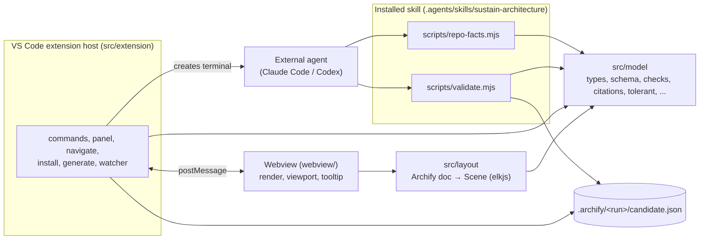

# Sustain architecture

> **Status: planned structure (M0).** Only the build/test scaffold exists. Everything below "Planned modules" describes the target from [spec §6](spec.md#6-repository-layout) and is replaced by a description of the built system from M1 onward (FR-DOC-02).

Sustain is a VS Code extension that shows a repository's architecture as an Archify diagram and opens the code cited by each node. Diagrams are produced by an external coding agent (Claude Code or Codex) running the bundled `sustain-architecture` skill; the extension itself never calls an LLM ([ADR 0002](adr/0002-external-coding-agent-generates-diagrams.md)).

## What exists today (M0)

| Path | Role |
|---|---|
| `src/extension/extension.ts` | Extension entry point; `activate()` registers nothing yet. Bundled to `dist/extension.js`. |
| `src/model/schemas/*.schema.json` | Archify v1 JSON Schemas, vendored byte-for-byte ([ADR 0013](adr/0013-archify-json-v1-and-archify-folder-layout.md)). |
| `skills/sustain-architecture/references/example.json` | Vendored example diagram; copied to `dist/skills/` by the build. |
| `fixtures/archify/` | 24 vendored Archify fixtures + README. |
| `esbuild.mjs` | Builds `dist/`; `--e2e` builds the e2e suite to `out/e2e/` ([ADR 0016](adr/0016-build-test-and-docs-check-harness.md)). |
| `scripts/check-docs.mjs` | `npm run check:docs`: ADR format, numbering, index and relative links (FR-DOC-03). |
| `test/unit/` | vitest (Node): module-boundary scan (NFR-QUAL-03), no-network scan (NFR-SEC-02), docs checker. |
| `test/dom/` | vitest (happy-dom) project for webview code; empty until M3. |
| `test/e2e/` | `@vscode/test-electron` launcher (`runTest.ts`, VS Code 1.141.0) and mocha TDD suite (`suite/`). |

## Planned modules

Allowed dependency directions (enforced by `test/unit/boundaries.test.ts`, NFR-QUAL-03):

* `src/model/` imports no `vscode`. Only `citations.ts`, `git.ts`, `runFolder.ts`, `discovery.ts` may import `node:fs`, `node:path`, `node:child_process`; `types.ts`, `tolerant.ts`, `checks.ts` are browser-safe. Model files import nothing outside `src/model/`.
* `src/layout/` is browser-safe and may import only `src/model/` and elkjs.
* `src/agent/` (CLI entry points), `src/extension/` and `webview/` sit on top of `model` and `layout`.

## Decisions

See the [ADR index](adr/README.md). Structure-relevant: agent runtime [0002](adr/0002-external-coding-agent-generates-diagrams.md), skill packaging [0004](adr/0004-one-skill-with-bundled-scripts.md)–[0007](adr/0007-validator-as-dependency-free-node-bundles.md), publish rule [0008](adr/0008-validator-publishes-draft-as-candidate.md), layout [0010](adr/0010-elkjs-layout-in-the-webview.md), viewer [0011](adr/0011-webview-panel-viewer-with-code-beside.md)–[0012](adr/0012-no-validation-on-load-tolerant-parsing.md), tooling [0015](adr/0015-typescript-esbuild-vitest-plain-svg-webview.md)–[0016](adr/0016-build-test-and-docs-check-harness.md).
