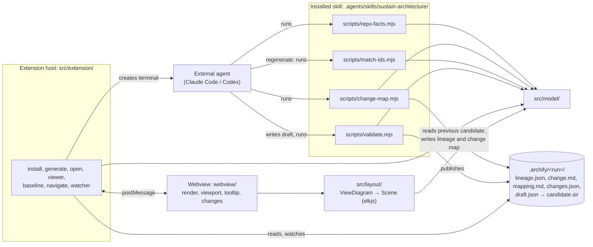
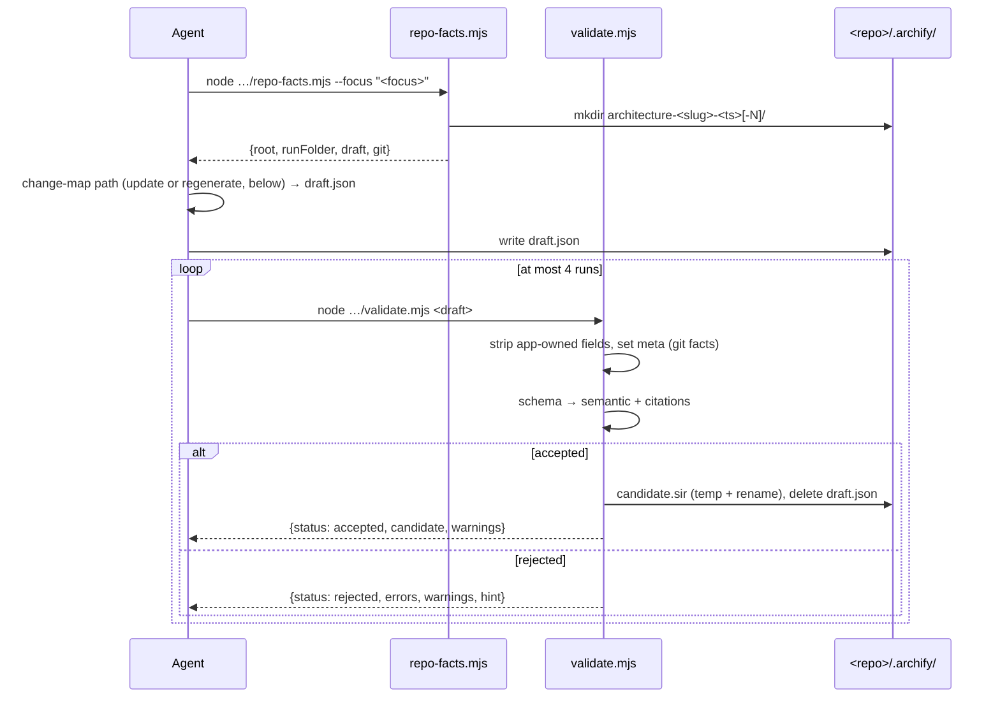
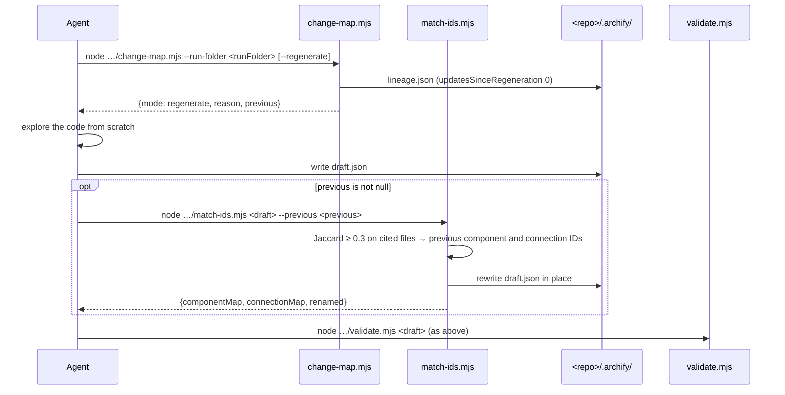
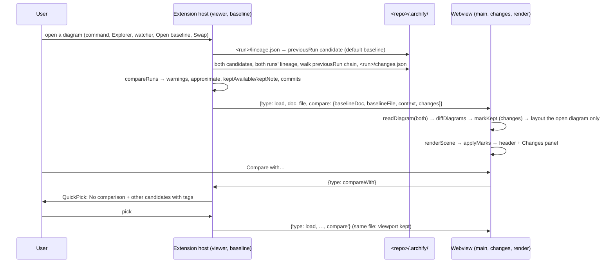

# Sustain architecture

Sustain is a VS Code extension that shows a repository's architecture as an Archify diagram and opens the code cited by each node. Diagrams are produced by an external coding agent (Claude Code or Codex) running the bundled `sustain-architecture` skill, whose scripts validate and publish the diagram; the extension itself never calls an LLM ([ADR 0002](adr/0002-external-coding-agent-generates-diagrams.md)).

## Components



## Modules

### `src/model/`

Pure TypeScript shared by the scripts, the extension host and the webview. No `vscode` import anywhere.

| File | Responsibility | Node APIs |
|---|---|---|
| `types.ts` | Archify v1 types (`ArchifyDoc`, `Component`, `SourceRef`, …), `Issue {code, pointer, message}`, `stringifyDocument` (2-space JSON + newline), `pointerToken`. Documents stay plain parsed JSON, so unmodelled fields survive rewrites (FR-MOD-01). | none (browser-safe) |
| `schema.ts` | `validateArchitecture(value)`: Ajv draft 2020-12 (`ajv/dist/2020`, `allErrors`, `strict: false`) over the vendored `schemas/*.schema.json`, `$ref`s resolved by `$id` in memory; errors → `Issue` with JSON pointers (FR-MOD-02). | none |
| `checks.ts` | `semanticChecks(doc)`: duplicate IDs, connections without `id` (`MissingId`, FR-UPD-07), unknown references, missing sources, overlapping/equal boundaries; `boundaryRelation` (FR-VAL-04). | none (browser-safe) |
| `deny.ts` | `isDenied(path)`: citation deny-list, any segment, case-insensitive (FR-VAL-05). | none |
| `citations.ts` | `citationPathOk`, `countLines`, `probeFile(rootReal, path)` (real-path confinement, regular file, ≤ 2 MiB, NUL sniff), `rangeProblem`, `checkCitations(doc, root)` (FR-VAL-05). | `node:fs`, `node:path` |
| `git.ts` | `collectGitFacts(root)` via fixed-argv `git` with `GIT_TERMINAL_PROMPT=0`; `sanitizeOrigin`, `parsePorcelainZ`, `repositoryFromGit` (FR-GIT-01); `baseReachable(root, base)` (`cat-file -e`, `merge-base --is-ancestor`) and `readChanges(root, base)` (`diff --name-status -z`, unified diff, `ls-files -z --others --exclude-standard`) against the working tree (FR-UPD-02/03). | `node:child_process`, `node:fs` |
| `runFolder.ts` | `slugify`, `runTimestamp`, `RUN_FOLDER_PATTERN`/`parseRunFolderName`, `createRunFolder` (collision `-N`), `locateDraft`, `publishCandidate` (temp + rename, then delete draft) (FR-RF-01, FR-VAL-06). | `node:fs`, `node:path` |
| `submission.ts` | `applyAppOwnedFields` (step 1, FR-VAL-02) and `checkSubmission(value, app, checkCitations)`: schema, then semantic + injected citation check (FR-VAL-03..06). | none (file access injected) |
| `tolerant.ts` | `readDiagram(value)` / `parseDiagram(text)` → `ViewDiagram` (FR-VIEW-03): skips components without a string id and duplicates, label falls back to id, unknown type → `external`, drops unresolved connections and boundary members, skips emptied boundaries and sources without a string path; reports skips as `<pointer>: <reason>`. | none (browser-safe) |
| `discovery.ts` | `listCandidates(root)`: `.archify/*/candidate.sir` inside the root, newest first (`compareCandidates`, FR-VIEW-02); `repoRootFor(file, folder)`: `<R>` for `<R>/.archify/<run>/<name>`, else the workspace folder, else the file's folder. | `node:fs`, `node:path` |
| `changeMap.ts` | `decideMode(facts)` (FR-UPD-02 rows), `diagramComponents`, `splitDiff`/`parseNameStatusZ`/`unquotePath`, `collectChanges` (untracked as added, previously dirty as modified/deleted, deny-listed and binary files name-only, repo-root `.archify/` left out), `mapChanges`, `renderChange` (`change.md`) and `renderMapping` (`mapping.md`) (FR-UPD-03, [ADR 0030](adr/0030-change-map-details-not-fixed-by-the-spec.md)). | none (browser-safe; git output and file reads injected) |
| `runChanges.ts` | `RunChanges` (`changes.json`: touched components with their changed files, uncited files, statuses A/M/D/R), `buildRunChanges(map, base, head)` from a `ChangeMap`, tolerant `parseRunChanges` (FR-CMP-02). | none (browser-safe) |
| `diagramDiff.ts` | `diffDiagrams(baseline, current)`: by-ID diff of two `ViewDiagram`s (component `id`; connection `id` or `~from→to`; boundary label, equal-member leftovers paired as renamed) with per-element status and changed fields, removed baseline elements and counts; `markKept(diff, current, touched)` (FR-CMP-03, [ADR 0032](adr/0032-change-view-details-not-fixed-by-the-spec.md)). | none (browser-safe) |
| `comparison.ts` | `compareRuns(current, baseline, lineageOf, changesParsed)`: warnings (different focus, unrelated, different repository, outside update history, reversed), `approximate`, `keptAvailable`/`keptNote`, header commits; `pickerTags` (FR-CMP-04). All facts injected. | none (browser-safe) |
| `lineage.ts` | `readLineage(runDir)` (tolerant: malformed → `null`; `baseCommit`/`headCommit` default to `null`) and `writeLineage` for `<run>/lineage.json` (FR-UPD-04, FR-CMP-01); `readRunChanges`/`writeRunChanges` for `<run>/changes.json` (FR-CMP-02). | `node:fs`, `node:path` |
| `matchIds.ts` | `matchIds(previous, draft, 0.3)`: one-to-one Jaccard matching of cited file sets, previous IDs for matched components and for connections whose mapped endpoints equal a previous connection's, `<id>-n<k>` for colliding new elements (FR-UPD-09). | none (browser-safe) |
| `messages.ts` | `HostMessage` / `WebviewMessage` / `Compare` types (protocol below). | none |

### `src/agent/`

CLI entry points bundled by `esbuild.mjs` into `dist/skills/sustain-architecture/scripts/*.mjs` (ESM, platform node, target node18, Ajv and schemas inlined; [ADR 0007](adr/0007-validator-as-dependency-free-node-bundles.md)).

* `repo-facts.ts` → `repo-facts.mjs [--focus <text>]`: creates the run folder, prints `{root, runFolder, draft, git}` ([ADR 0018](adr/0018-repo-facts-creates-the-run-folder.md)).
* `change-map.ts` → `change-map.mjs --run-folder <runFolder> [--regenerate]`: finds the previous candidate of the same slug, decides the mode (`decideMode`, then the 2 MiB `change.md` limit), writes `lineage.json` (with the subject and date of the base and head commits from `commitInfo`) and in update mode `change.md`/`mapping.md`/`changes.json`, prints `{mode, reason, previous, baseRevision, head, changeFile, mappingFile, touchedComponents, untouchedComponents, uncitedFiles}` ([ADR 0029](adr/0029-update-the-previous-diagram-incrementally.md), [ADR 0030](adr/0030-change-map-details-not-fixed-by-the-spec.md)).
* `match-ids.ts` → `match-ids.mjs <draft> --previous <candidate>`: rewrites a regenerated draft in place with `matchIds`, prints `{componentMap, connectionMap, renamed}`.
* `validate.ts` → `validate.mjs <draft>`: locate draft → parse → git facts → `checkSubmission` → publish or report ([ADR 0017](adr/0017-validator-output-contract-and-exit-codes.md), [ADR 0019](adr/0019-validator-deviations-from-the-prototype-gate.md)).

### `skills/sustain-architecture/`

The static skill, copied as-is to `dist/skills/sustain-architecture/` next to the built scripts ([ADR 0004](adr/0004-one-skill-with-bundled-scripts.md), [ADR 0005](adr/0005-manual-invocation-and-claude-pre-approvals.md)).

* `SKILL.md`: frontmatter (manual invocation, Claude pre-approvals) and the eight imperative steps of FR-UPD-05 (focus with optional `--regenerate`, `repo-facts.mjs`, `change-map.mjs`, format reference, update mode, regenerate mode with `match-ids.mjs`, validate and repair, report); `.archify/` stays off limits except the previous candidate, `mapping.md` and `change.md` in update mode; every script is referenced by its repo-root path `.agents/skills/sustain-architecture/scripts/…`.
* `agents/openai.yaml`: Codex display name and `allow_implicit_invocation: false`.
* `references/archify-format.md`: authoring guidance adapted from the prototype's system prompt, with validation described as the `validate.mjs` steps (FR-SKL-03); connection `id` required (FR-UPD-06).
* `references/example.json`: vendored Archify candidate, a shape example only.

### `src/extension/`

| File | Responsibility |
|---|---|
| `extension.ts` | `activate()` (on `onStartupFinished`, the contributed commands and, implicitly, the `sustain.architecture` custom editor) starts the `CandidateWatcher`, registers the commands and the `ArchitectureEditorProvider`, and returns the e2e test hook `{viewers(), postFromWebview(file, msg)}`, `viewers()` being `{file, baseline, active, title}[]` (FR-TEST-01, [ADR 0026](adr/0026-activate-test-hook-and-happy-dom-tests.md)). |
| `folders.ts` | `pickRepoRoot()`: the only folder, a QuickPick of folders, or "Open a folder first." (FR-WS-01). |
| `skillFiles.ts` | No `vscode`: target paths, `skillInstalled`, `writeSkill` (remove both targets, copy to `.agents`, relative `dir`/`junction` link from `.claude`, copy on link failure) ([ADR 0006](adr/0006-install-skill-into-agents-with-claude-symlink.md)). |
| `install.ts` | `installSkill()`: modal overwrite question, `writeSkill`, success notification (FR-INS-01). |
| `agents.ts` | No `vscode`: the two agents, `agentPrompt(agent, focus, regenerate)` (`/sustain-architecture [--regenerate] …`, `$sustain-architecture [--regenerate] …`), `findOnPath` (PATH, PATHEXT). |
| `generate.ts` | FR-GEN-01 flow: folder → install offer → focus → "Update the latest diagram" / "Regenerate from scratch" when `listCandidates` is not empty (FR-UPD-08) → agent → terminal with `shellPath`/`shellArgs` or the "not found" warning with "Copy prompt" ([ADR 0020](adr/0020-launch-agent-terminal-with-shellpath-and-shellargs.md), [ADR 0021](adr/0021-command-ui-details-not-fixed-by-the-spec.md)). |
| `open.ts` | `Open Architecture`: newest `candidate.sir` of the chosen folder via `showViewer` in `defaultColumn()`, or "No architecture diagram yet." with "Generate" (FR-VIEW-01). |
| `viewer.ts` | Read-only custom editor `sustain.architecture` on `*.sir` ([ADR 0033](adr/0033-custom-editor-for-sir-files.md)). `ArchitectureEditorProvider.resolveCustomEditor` creates one `ArchitectureViewer` per tab (`retainContextWhenHidden: false`): it reads the file, tolerant-parses it, posts `load` (with `compare`) / `empty`, re-sends on `ready` and when visible (FR-VIEW-04, [ADR 0025](adr/0025-viewer-details-not-fixed-by-the-spec.md)). Each viewer keeps its own baseline (default or chosen, FR-CMP-05) and handles `compareWith` (QuickPick "Compare with"), `openBaseline` / `swap` (open or reveal the baseline's viewer in the same group) and `openFile` (only paths from the `changes` it last sent) (FR-CMP-06/07, [ADR 0032](adr/0032-change-view-details-not-fixed-by-the-spec.md)). `showViewer(file, {viewColumn, preserveFocus?, baseline?})` reveals and reloads an open viewer of the file or runs `vscode.openWith` for a new non-preview tab; `defaultColumn()` is `Active` without visible text editors, else `Beside`. |
| `baseline.ts` | No `vscode`: `defaultBaseline(root, file)` (the lineage's `previousRun` candidate), `buildCompare(root, file, baseline)` (reads both runs' facts, `compareRuns`, `changes.json` when it applies), `pickerItems` (FR-CMP-05/06, [ADR 0031](adr/0031-compare-the-open-diagram-with-a-chosen-baseline.md)). |
| `html.ts` | No `vscode`: `webviewCsp`, `webviewHtml` (CSP meta, stylesheet link, one nonce'd script) (NFR-SEC-01). |
| `sourceTarget.ts` | No `vscode`: `resolveSource(root, source)` → open with lines, open with a stale-line warning, or "Invalid source path" / "Stale reference … no longer exists" (FR-NAV-03). |
| `navigate.ts` | `openSource`: "no source references" status message, then `openSourceRef(root, source, column)`: error or open in the column that is not the viewer's (`viewer === 1 ? 2 : 1`), select whole lines, reveal, 2 s `editor.rangeHighlightBackground` highlight (FR-NAV-01/02, [ADR 0027](adr/0027-navigation-and-watching-details.md)). `openFile` (FR-CMP-07) reuses `openSourceRef` with a bare `{path}`. |
| `watchLogic.ts` | No `vscode`: `ChangeBatch` (300 ms debounce, per-file merge), `viewerAction(change, viewerFacts)` per open viewer (reload / deleted / baselineChanged / baselineDeleted, or nothing) and `newRunAction(change, viewers)` (open in the group of a viewer of the same folder, a visible one first / notify / nothing); `ViewerFacts {root, file, baseline, visible}`. |
| `watcher.ts` | `CandidateWatcher`: one `FileSystemWatcher` per workspace folder on `.archify/*/candidate.sir`, applying `viewerAction` to every open viewer (FR-WAT-01, FR-CMP-08) and `newRunAction` for a new newest run: open it with `preserveFocus` in the group of a viewer of that folder, or a "New architecture diagram" notification. |

### `src/layout/`

Browser-safe; runs in the webview ([ADR 0010](adr/0010-elkjs-layout-in-the-webview.md)). Entry `layout.ts › layoutDiagram(diagram, {measure, viewport}) → Promise<Scene>` (types in `scene.ts`).

| File | Responsibility |
|---|---|
| `mode.ts` | `authoredRects`: authored mode when every component has `pos` or a grid cell (Archify grid defaults), `size` default 120×60 (FR-LAY-01). |
| `measure.ts` | `autoNodeSize`: label 14 px bold, sublabel 12 px, tag 11 px, padding 12/10, at least 120×60; the font sizes the renderer also uses. |
| `elk.ts` | `runElk(input, direction)`: elkjs `layered`, orthogonal, `INCLUDE_CHILDREN`, spec spacings, ROOT coordinates (FR-LAY-02, [ADR 0023](adr/0023-auto-layout-direction-by-fit-scale.md)). |
| `boundaries.ts` | `memberSets`, `hierarchy` (placement and parents, FR-LAY-03), `overlayRect` (16 px), `authoredBoundaryRects` (30/50 px) ([ADR 0022](adr/0022-authored-straight-edges-and-overlay-boundaries.md)). |
| `edges.ts` | `straightEdge` (clipped), `selfLoop`, `labelAnchor` (FR-LAY-04). |
| `geom.ts` | `center`, `boundingBox`, `pad`. |
| `layout.ts` | Mode choice, both ELK directions, choice by fit scale (ties RIGHT), translation to a 40 px origin, `bounds` with a 40 px margin. |

### `webview/`

Bundled into `dist/webview.js` (IIFE, browser, minified, elkjs included) and `dist/webview.css`.

| File | Responsibility |
|---|---|
| `main.ts` | Builds the DOM (`div.app` > `div.header` and `div.stage` > `svg.canvas` > `g.viewport`, toolbar, `aside.changes`, empty state; tooltip), posts `ready`, handles `load` (tolerant parse → `compareDiagrams` when `compare` is set → canvas text measurement in `--vscode-font-family` → `layoutDiagram` at the canvas size → render → marks → fit unless the same file is reloaded, keeping clear of the expanded Changes panel) and `empty`; persists the Changes toggle and collapse state with `getState`/`setState` (FR-CMP-12). |
| `changes.ts` | `compareDiagrams` (tolerant parse of the baseline, `diffDiagrams`, `markKept`), `ChangesView`: the header (commits, relative dates, uncommitted files, counts, "approximate", Compare with…, Changes toggle, warnings with Swap) and the Changes panel (Added, Removed, Changed, Code changed kept, Not in any component, note, Open baseline; rows fit the viewport or post `openFile`) (FR-CMP-09/11, [ADR 0032](adr/0032-change-view-details-not-fixed-by-the-spec.md)). |
| `render.ts` | `renderScene`: boundaries, edges with arrowheads, edge labels with halo, nodes with label/sublabel/tag (FR-VIEW-05, [ADR 0024](adr/0024-theme-colour-mapping-and-svg-styling.md)); `applyMarks` adds or removes status classes and `NEW`/`CHANGED`/`RENAMED`/`KEPT` badges without re-running layout, `elementBox` for fit-to-element (FR-CMP-10). |
| `viewport.ts` | Pure math (`fitView`, `zoomAt`, `panBy`, 10–400 % clamp) and `ViewportController` (drag, wheel, pinch, toolbar Fit/−/+/100 %, keys `+ = - 0 f`, `fitRect` with 40 px padding, `rightInset` for the panel overlay) (FR-VIEW-06, FR-CMP-11). |
| `tooltip.ts` | `TooltipController`: 300 ms show, 200 ms hide, sources as `path:line–end_line` buttons posting `openSource` (FR-VIEW-07); with marks on, a status line and the component's changed files posting `openFile` (FR-CMP-12). |
| `click.ts` | `NodeClicks`: press and release on the same node within 4 px posts `openSource` with index 0 (FR-NAV-01). |
| `styles.css` | Theme-variable styling only; change statuses use the `--vscode-gitDecoration-*` colours. |

### Dependency rules

Enforced by `test/unit/boundaries.test.ts` (NFR-QUAL-03):

* `src/model/` imports no `vscode` and nothing outside `src/model/` (plus `ajv` in `schema.ts`). Only `citations.ts`, `git.ts`, `runFolder.ts`, `discovery.ts`, `lineage.ts` may import `node:fs`, `node:path`, `node:child_process`; `types.ts`, `tolerant.ts`, `checks.ts`, `changeMap.ts`, `matchIds.ts`, `runChanges.ts`, `diagramDiff.ts`, `comparison.ts` import no Node built-in (the last three run in the webview or take injected facts).
* `src/layout/` is browser-safe and may import only `src/model/` and elkjs.
* `src/agent/`, `src/extension/` and `webview/` sit on top of `model` and `layout`. No module makes network requests (`test/unit/noNetwork.test.ts`, NFR-SEC-02).

## Flows

### Generate → validate → publish

`Sustain: Generate Architecture` creates a terminal running `claude "/sustain-architecture [--regenerate] <focus>"` or `codex "$sustain-architecture [--regenerate] <focus>"` with the repo root as cwd; from there the agent follows `SKILL.md`. Between creating the run folder and writing the draft it runs `change-map.mjs`, which picks one of the two paths below; this diagram shows what both share:



### Change map → patch → validate (update run)

When a previous candidate of the same slug exists and nothing forces a regeneration, the agent patches it ([ADR 0029](adr/0029-update-the-previous-diagram-incrementally.md)):

```mermaid
sequenceDiagram
  participant A as Agent
  participant CM as change-map.mjs
  participant G as git
  participant FS as <repo>/.archify/
  participant V as validate.mjs
  A->>CM: node …/change-map.mjs --run-folder <runFolder>
  CM->>FS: newest other candidate.sir with the same slug, its lineage.json
  CM->>G: rev-parse, status (FR-GIT-01); cat-file -e, merge-base --is-ancestor <base>
  CM->>G: diff --name-status -z <base>, diff --unified=3 <base>, ls-files --others
  CM->>CM: collectChanges → mapChanges → renderChange (≤ 2 MiB)
  CM->>FS: change.md, mapping.md, lineage.json (updatesSinceRegeneration + 1)
  CM-->>A: {mode: update, previous, changeFile, mappingFile, touchedComponents, …}
  A->>FS: read previous candidate, mapping.md, change.md (never cited)
  A->>A: re-read touched components and uncited changed files only
  A->>FS: write draft.json = previous candidate, patched; untouched components unchanged
  A->>V: node …/validate.mjs <draft> (as above)
```

### Regenerate → match IDs → validate (regeneration run)

`change-map.mjs` chooses this path with `--regenerate`, without a previous candidate or git facts, without a known or reachable base commit, after a dirty baseline (> 200 paths), after 5 updates, or when `change.md` would exceed 2 MiB ([ADR 0030](adr/0030-change-map-details-not-fixed-by-the-spec.md)):



### Open → layout → render

```mermaid
sequenceDiagram
  participant U as User
  participant H as Extension host
  participant W as Webview
  U->>H: Sustain: Open Architecture (or open a .sir file)
  H->>H: pickRepoRoot, listCandidates → newest; showViewer
  alt a viewer of the file is open
    H->>H: reveal and reload it
  else
    H->>H: vscode.openWith(file, sustain.architecture) → resolveCustomEditor → new ArchitectureViewer
  end
  H->>H: read file, parseDiagram (tolerant)
  alt unreadable / no components
    H-->>U: error "Can't show `<file>`: <reason>"
    H->>W: {type: empty, message}
  else diagram
    H->>W: set CSP html, {type: load, doc, file, compare}
  end
  W->>H: {type: ready}
  H->>W: {type: load, doc, file, compare} (again)
  W->>W: readDiagram → measure (canvas) → layoutDiagram (ELK RIGHT and DOWN) → renderScene → fit
```

### Open → resolve baseline → load → diff → render (change view)

Every `load` carries the comparison the host resolved ([ADR 0031](adr/0031-compare-the-open-diagram-with-a-chosen-baseline.md), [ADR 0032](adr/0032-change-view-details-not-fixed-by-the-spec.md)):



### Click → resolve → open / stale

```mermaid
sequenceDiagram
  participant U as User
  participant W as Webview
  participant H as Extension host
  participant E as Editor
  U->>W: click node (< 4 px movement) or tooltip source
  W->>H: {type: openSource, componentId, index}
  H->>H: component from the last loaded diagram
  alt no sources
    H-->>U: status bar "`<label>` has no source references" (3 s)
  else resolveSource(root, sources[index])
    alt invalid path / outside root
      H-->>U: error "Invalid source path: `<path>`"
    else missing / not a file
      H-->>U: error "Stale reference: `<path>` no longer exists"
    else lines beyond the file
      H->>E: open in the other column, no selection
      H-->>U: error "Stale reference: `<path>` has N lines; …"
    else ok
      H->>E: open in the other column, select lines, highlight 2 s
    end
  end
```

### Watching

A `FileSystemWatcher` per workspace folder feeds a 300 ms debounce. Each changed `candidate.sir` is applied to every open viewer tab: it reloads a viewer whose file changed, shows "This diagram was deleted." in a viewer whose file was deleted (the tab stays), re-sends the comparison when a viewer's baseline changed, or drops that baseline with "Baseline diagram was deleted; showing no comparison.". A created candidate that is now its folder's newest and that no viewer shows opens, with its default baseline and `preserveFocus`, in the group of an open viewer of the same folder (the old tab stays); otherwise it is announced with "Open" ([ADR 0027](adr/0027-navigation-and-watching-details.md), [ADR 0033](adr/0033-custom-editor-for-sir-files.md), FR-CMP-08). The watcher only looks at `candidate.sir` and the validator only at `draft.json`, so `lineage.json`, `changes.json`, `change.md` and `mapping.md` never trigger anything; they are written before the candidate is published.

### Webview message protocol

| Direction | Message | Meaning |
|---|---|---|
| host → webview | `{type: "load", doc, file, compare}` | Draw the parsed diagram JSON `doc` from absolute path `file`; same `file` as before keeps the viewport. `compare` is `null` or `{baselineDoc, baselineFile, context, changes}`: the baseline JSON, the comparison context (`ComparisonContext`) and the open run's `changes.json` when it applies. |
| host → webview | `{type: "empty", message}` | Clear the drawing and show `message`. |
| webview → host | `{type: "ready"}` | The page started; the host (re)sends the current state. |
| webview → host | `{type: "openSource", componentId, index}` | Open `sources[index]` of that component (node click: index 0; tooltip entry: its index). |
| webview → host | `{type: "compareWith"}` | Show the "Compare with" QuickPick. |
| webview → host | `{type: "openBaseline"}` / `{type: "swap"}` | Open or reveal the baseline's own viewer tab in the same group, with its default baseline / with the file you came from as baseline. |
| webview → host | `{type: "openFile", path}` | Open a changed file; only paths in the `changes` last sent are accepted. |

## On-disk layout

| Path | Contents |
|---|---|
| `<repo>/.archify/architecture-<slug>-<YYYYMMDD-HHMMSS>[-N]/` | One run: `draft.json` while unvalidated or after a failed run; `candidate.sir` (Archify JSON v1) once accepted ([ADR 0008](adr/0008-validator-publishes-draft-as-candidate.md), [ADR 0013](adr/0013-archify-json-v1-and-archify-folder-layout.md), [ADR 0033](adr/0033-custom-editor-for-sir-files.md)); `lineage.json` (mode, reason, previous run, base and HEAD revisions with commit subject and date, dirty paths, updates since the last regeneration) and, in update runs, `change.md`, `mapping.md` and `changes.json` ([ADR 0029](adr/0029-update-the-previous-diagram-incrementally.md), [ADR 0031](adr/0031-compare-the-open-diagram-with-a-chosen-baseline.md)). |
| `<repo>/.agents/skills/sustain-architecture/` | Installed skill: real files copied from `dist/skills/sustain-architecture/` ([ADR 0006](adr/0006-install-skill-into-agents-with-claude-symlink.md)). |
| `<repo>/.claude/skills/sustain-architecture` | Relative symlink `../../.agents/skills/sustain-architecture` (`junction` on Windows); a copy if the link cannot be created. |
| `dist/extension.js` | Extension host bundle (CJS, `vscode` external). |
| `dist/skills/sustain-architecture/` | Static skill files from `skills/` plus `scripts/repo-facts.mjs`, `scripts/change-map.mjs`, `scripts/match-ids.mjs`, `scripts/validate.mjs`. |
| `dist/webview.js`, `dist/webview.css` | Webview bundle (IIFE, elkjs included, minified) and stylesheet; the only `localResourceRoots`. |
| `out/e2e/`, `out/test-scripts/` | Test builds (gitignored, never packaged): the e2e suite (scenarios `single`, `empty`, `multi`, each in its own VS Code launch), and the script bundles the unit tests run ([ADR 0016](adr/0016-build-test-and-docs-check-harness.md)). |
| `sustain-<version>.vsix` | `npm run package` (`vsce package --no-dependencies`, build via `vscode:prepublish`); `.vscodeignore` ships only `dist/**`, `package.json`, `README.md`, `THIRD_PARTY_NOTICES.md` (and `LICENSE` if one is added). |

## Trust boundaries

* **No network:** no module imports `http`/`https`/`http2`/`net`/`tls`/`dgram` or uses `fetch`/`XMLHttpRequest`/`WebSocket` (NFR-SEC-02).
* **Repo-root confinement:** citation paths must be relative `/`-paths without `.`/`..` segments; their real path (symlinks resolved) must stay inside the repo root's real path — checked by the validator (`citations.ts`) and again on every click (`sourceTarget.ts`), never on load.
* **Deny-list:** `.git`, `.archify`, credential rc files, `.env*` (except examples), SSH key names and key/cert extensions can never be cited (`deny.ts`). The change map lists changed deny-listed and binary files by name only, never their content or blob hashes; the skill lets the agent read only the previous candidate, `mapping.md` and `change.md` under `.archify/`, and FR-VAL-05 still rejects any citation of them.
* **Git:** fixed argv, no shell, no terminal prompts, stdin closed; HTTP(S) credentials are stripped from the origin before it is written anywhere (`git.ts`). The change-map reads take only a validated 40-hex base revision as an extra argument and never write to the repository.
* **Agent launch:** the prompt is a single argv element of the resolved CLI, never parsed by a shell ([ADR 0020](adr/0020-launch-agent-terminal-with-shellpath-and-shellargs.md)). Writes by the agent still need approval in Claude Code ([ADR 0005](adr/0005-manual-invocation-and-claude-pre-approvals.md)).
* **Webview CSP:** `default-src 'none'; script-src 'nonce-…'; style-src <cspSource>`; `localResourceRoots` is `dist/`; the webview receives the diagram JSON, the baseline diagram JSON and change metadata (paths, git statuses, commit subjects and dates) only, never file contents (`html.ts`, `viewer.ts`, NFR-SEC-01). Repository text is inserted as text, never as HTML. `openFile` from the webview opens only paths the host itself sent, after the repo-root and stale checks of `sourceTarget.ts`.

## Decisions

See the [ADR index](adr/README.md).
