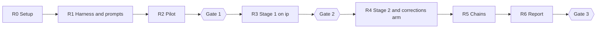

# Change collection research: specification

- Status: Accepted, 2026-10-17 (from the design interview with the owner)
- Product context: [product spec](../spec.md) · [architecture](../architecture.md) · [ADR 0002](../adr/0002-external-coding-agent-generates-diagrams.md)
- Executor: one long-running, mostly autonomous Claude Code session (the **research agent**). It follows §10 (process) and §11 (deviation policy) and stops at the three owner gates (§9).

This document is the contract for that session. It defines what is studied, how the runs are isolated and scored, and the decision rule, which is fixed before any result exists.

## 1. Background

Sustain's skill generates every architecture diagram from scratch, like Archify. Archify's `compare` command pairs diagram elements only by authored `id`. The skill never tells the agent to reuse IDs, and Archify ships no mechanism that keeps them stable across commits.

Two existing runs on `.smoke_repo/cs2103-ip`, made 20 minutes apart at the same commit `6b31473`, show the problem:

| Run | Component IDs | Connections with `id` |
|---|---|---|
| `architecture-cs2103-ip-20261010-101345` | desktop, controller, commands, tasklist, taskmodel, storage, csvfile | 0/9 |
| `architecture-cs2103-ip-20261010-104205` | launcher, ui, picker, model, tasklist, commands, storage, file | 0/14 |

The two diagrams share 3 component IDs, and neither has a single connection ID, although the code is identical. A diff between them is noise.

## 2. Goal, hypothesis and research questions

**Goal.** Find out how Sustain should produce the diagram for a newer commit, with the previous diagram as context, so that the diff between the two diagrams reflects the code change and nothing else.

**Hypothesis H1 (falsifiable).** Incremental update from the previous diagram beats independent regeneration (the control, S0) on identity stability and abstraction stability. It keeps hand corrections made to the previous diagram. Its errors do not accumulate beyond those of a fresh diagram. Ties are broken by cost. The report states, for every metric, which condition wins, including the metrics on which S0 wins.

The owner's position, which H1 tests: mistakes in a diagram are fixable by manual or LLM-driven edits. That holds only if later updates keep those edits (M6) and errors do not pile up (M7).

| ID | Research question |
|---|---|
| RQ1 | Does any incremental strategy (S1, S2, S4) beat S0 on M1–M4 beyond the same-commit noise floor? |
| RQ2 | Does a deterministic post-hoc ID matcher (S3) reach the same stability without the old diagram in the agent's context? |
| RQ3 | Which change input (CI-A, CI-B, CI-C) works best with the strongest strategies? |
| RQ4 | Do hand corrections survive an update when the code they describe did not change (M6)? |
| RQ5 | Do incremental errors accumulate over a chain of updates compared with fresh diagrams (M7)? |

Priorities: identity instability and abstraction drift are primary (M1–M4). Cost (M5) is secondary and breaks ties. Lost knowledge is observed only.

## 3. Scope and non-goals

In scope:

- **(i) Change input.** What the agent is told about the change between two commits.
- **(ii) Update strategy.** How the old diagram plus that input becomes the new diagram.

Non-goals:

- Presenting diagram diffs (a Before / Delta / After view). Archify's ID-based `compare` covers it once IDs are stable.
- Cost analysis: pricing models, budgets, how cost scales with repository size. Cost is recorded (M5) and used only as the tie-break; analysis is a later milestone.
- Approaches outside Sustain's current architecture: an LLM call or network request in the extension, embeddings, code-graph services. Such ideas are listed in the report as out of bounds, not tested. Allowed building blocks: the external agent working through the skill ([ADR 0002](../adr/0002-external-coding-agent-generates-diagrams.md)), and deterministic Node scripts bundled with the skill beside `repo-facts.mjs` and `validate.mjs`.
- Codex. Claude Code is the only agent under test.
- End-to-end tests through the VS Code extension. Test agents receive the skill instructions in their prompt and produce candidate JSON; scoring works on that JSON.
- Changing Sustain's product code. Results become a proposal (§9, Gate 3). Adopting an incremental update reverses the product spec's non-goal "A `sustain-architecture-refresh` skill. Re-run the skill instead.", which needs owner approval under the product spec's §10.

## 4. Glossary

| Term | Meaning |
|---|---|
| Pair | A (base commit, head commit) of one repository. |
| Same-commit pair | A pair with base = head. Any diagram difference is noise. |
| Planted pair | A pair whose head commit is a known architectural change committed by the planter on a scratch branch (§6.3). |
| Base diagram | A candidate generated by S0 at the base commit. Every pair has three: B1, B2, B3. |
| Cell | One (pair, strategy, change input) combination. |
| Run | One test-agent execution of one repetition of one cell. |
| Test agent | A headless `claude -p` process that produces one candidate (§7). |
| Judge | An in-session subagent of the research agent that labels diffs, checks role equivalence or checks claims (§6.4). Never a test agent. |
| Cited file set F(c) | The set of `sources[].path` values of component `c`. |
| Touched file | A path that `git diff --name-status <base> <head>` lists as changed, added, deleted or renamed. A rename touches both the old and the new path. |

## 5. Corpus

Repositories, used only as scratch clones (§7.2). The originals under `.smoke_repo/` are never modified.

| Repo | Language | History | Role |
|---|---|---|---|
| `.smoke_repo/cs2103-tp` | Java 17, Gradle 7.4.2 | 1984 commits, 823 first-parent, 412 merges, numbered PR merges | Real pairs: a PR merge commit against its first parent (exactly the PR's change), sampled small / medium / large by diff size. One chain over consecutive first-parent merges. |
| `.smoke_repo/cs2103-ip` | Java, Gradle 7.6.2 | 91 commits, 21 merges | Real pairs at commit distance 1, ~5 and ~20 along the first-parent line. One chain over consecutive commits. Stage 1 screening repository. |
| `.smoke_repo/HyperTrack` | Python ≥ 3.13 | 26 commits, linear | Real pairs at distance 1, ~5 and ~10. One chain. The check on a codebase that isn't a course template. |

Each repo also has one same-commit pair (§6.2) and about 6 planted pairs (§6.3).

Template risk: tp derives from AddressBook-Level3 and ships `docs/DeveloperGuide.md` with its own architecture diagram; ip is the Duke chatbot template. The model may reproduce the template's canonical structure from training data or from the docs, which would make every condition look stable. Docs stay in the clones. The scorer records, per candidate, the share of citations under `docs/`, and every result is reported per repository.

Existing diagrams under `.smoke_repo/*/.archify/` and `.smoke_repo/HyperTrack/.archify-old/` are not used as base diagrams: they come from earlier skill versions.

## 6. Experimental design

### 6.1 Strategies

| ID | Strategy | Old diagram in the agent's context | Change input |
|---|---|---|---|
| S0 | **Control.** Independent regeneration at head with the frozen skill (§7.1). | no | none |
| S1 | **Hint.** Regenerate at head following the skill; the old diagram is given as context. Keep IDs for components and connections whose responsibility is unchanged. | yes | yes |
| S2 | **Patch.** Start from the old JSON, apply what the change input implies, re-verify the citations of touched components, run the validator. | yes | yes |
| S3 | **Post-hoc match.** Run S0, then a deterministic script reassigns base IDs to head elements by cited-file overlap. | no (script only) | none |
| S4 | **Hybrid.** A script maps diff hunks to the base components whose cited files they touch and lists changed files no component cites. The agent re-explores only those components and files, patches the diagram, and keeps untouched components unchanged unless a changed file creates a new relationship with them. | yes | yes, plus the mapping |

Rules for all strategies:

- Every strategy uses the frozen skill with one addition: every connection has a unique `id`. Missing connection IDs are not repaired. Under ID-based matching, a connection without an `id` scores as removed plus added.
- The incremental strategies (S1, S2, S4) in repetition *i* update base diagram B*i* of the pair. S3 in repetition *i* matches against B*i*. S0 and S3 generate the head diagram independently.
- The S3 matcher works as follows: Jaccard similarity of cited file sets; one-to-one assignment, highest similarity first; ties broken by equal `label`, then by `id`. A connection keeps its base `id` when both endpoints were mapped and the mapped (`from`, `to`) pair equals a base connection's. Its threshold is fixed at Gate 1, before any S3 run. It must differ from M2's 0.5 and is never tuned on results.
- The research agent writes the instruction addenda for S1, S2 and S4 in milestone R1. They are frozen at Gate 1 (§8).

### 6.2 Change inputs

| ID | Content |
|---|---|
| CI-A | `git diff --name-status <base> <head>` plus `git diff --unified=3 <base> <head>` |
| CI-B | `git diff --name-status <base> <head>` plus `git log --format='%h %s%n%b' <base>..<head>` |
| CI-C | Diff hunks grouped by the base components whose cited files they touch, plus the list of touched files no component cites |

Stage 1 uses CI-A only. S0 and S3 take no change input, so they have a single cell per pair in every stage.

### 6.3 Pairs

- **Same-commit pairs.** At least 3 repetitions of every condition per repository in every stage the repository takes part in. The S0 same-commit M3 value is the **noise floor**.
- **Planted pairs.** The **planter**, an in-session subagent of the research agent, creates about 6 per repository. Each is one commit on a scratch branch whose parent is a real commit.
  - Each pair carries exactly one change type from §6.4. Together a repository's planted pairs cover every type at least once.
  - Two are negative controls: one *evidence only* change and one *not architectural* change.
  - The true change list (same schema as J1 output, §6.4) is written before any diagram of that pair exists.
  - Planted code must compile: `./gradlew compileJava --offline` for the Java repos, `python3 -m py_compile` on changed files for HyperTrack. Tests need not pass.
- **Real pairs.** As in §5. The research agent proposes the exact commits at Gate 1, with the diff size of each.

### 6.4 Change taxonomy and judge tasks

Architectural change types:

| Type | Includes |
|---|---|
| Component | added, removed, split, merged, renamed with the same role |
| Responsibility | moved from one component to another |
| Connection | added, removed, endpoint changed, protocol or label changed |
| Boundary | a component's boundary membership changed |
| Evidence only | code behind a component changed, its role did not (cited lines moved or edited) |
| Not architectural | formatting, tests, docs, build tweaks |

Scoring rule for *evidence only*: correct if the diagram shows the element as `evidence-changed` or unchanged; spurious if it shows `changed`, `added` or `removed`. `evidence-changed` entries never count toward M3; their count is reported separately for information.

Judge tasks, all on the pinned model (§7.3):

| ID | Task | Input | Output |
|---|---|---|---|
| J1 | Label the architectural changes of a pair | `git diff` and commit messages of the pair, the taxonomy. **No diagram.** Run once per pair, before any head diagram of the pair exists. | List of `{type, files[], description}` |
| J2 | Role equivalence | Base and head component (label, sublabel, cited code) that share an `id` | `same-role` or `different-role` with a reason |
| J3 | Claim check | One component's label and sublabel plus its cited code at a given commit | `supported` or `stale` with a reason |

Calibration against the planted pairs (known truth). Each task is scored separately. If precision or recall is below 0.8, every criterion that depends on that task is reported as **indicative only**:

| Task | Planted truth | Dependent criteria |
|---|---|---|
| J1 | the planted change list | C2, C3 on real pairs |
| J2 | "renamed, same role" plants are `same-role`; "responsibility moved" plants are `different-role` | C1, C2 (role check) |
| J3 | after "responsibility moved" or "component removed" plants, the base diagram's claim for that component is `stale`; after "evidence only" plants it is `supported` | C5 |

### 6.5 Metrics

All metrics are computed by a deterministic scoring script over accepted candidate JSON, the J1 labels and the J2/J3 verdicts.

| ID | Metric | Definition |
|---|---|---|
| M1 | ID retention | U = base components whose cited files are all untouched. M1 = share of U for which the head diagram has a component with the same `id` and `type` whose role check passed. |
| M2 | ID-free alignment | Match base and head components one-to-one by Jaccard(F(b), F(h)) ≥ 0.5, highest first. Report the share of base components matched and the change in component count. **Split:** a base `b` with two or more head `h` where \|F(b)∩F(h)\| / \|F(h)\| ≥ 0.5. **Merge:** a head `h` with two or more base `b` where \|F(b)∩F(h)\| / \|F(b)\| ≥ 0.5. |
| M3 | Spurious diff | Diff entries from ID matching with Archify `compare` semantics: components and connections by `id`, boundaries by `kind` + `label`. An `added`, `removed` or `changed` entry is **explained** if a ground-truth change of a compatible type has `files[]` intersecting the element's cited files (base or head; for a connection, its endpoints' files). Unexplained entries are spurious. IDs whose J2 role check failed count as spurious. M3 = spurious entries per pair. |
| M4 | Missed changes | Share of ground-truth changes of an architectural type (not *evidence only*, not *not architectural*) that no compatible diff entry touching their files explains. |
| M5 | Cost | `total_cost_usd` from the stream-json result, summed over the run including its subagents, with the token breakdown (input, output, cache read, cache write); wall-clock time; tool-call count; validator runs. |
| M6 | Correction survival | Share of planted corrections (§6.7) unchanged at head: text corrections compare field values, merges compare component structure. Only corrections on components whose cited files are untouched are scored. |
| M7 | Stale-claim rate | In chains, every 5 steps and at the last step: share of components that J3 marks `stale` at that commit. |
| AR | Acceptance rate | Share of non-contaminated runs that reach `accepted` within the validator's repair limit and the time limit. |

Role checks (J2) run on every retained `id` of S3 and on a random 20 % sample of retained IDs of every other strategy. The report gives the sample's failure rate.

Failed or timed-out runs are excluded from M1–M4, M6 and M7 and counted in AR. Contaminated runs (§7.4) are discarded and re-run.

### 6.6 Stages

| Stage | Pairs | Strategies × inputs | Repetitions |
|---|---|---|---|
| Pilot (R2) | 2 real ip pairs | S0, S2 × CI-A | to about 10 runs in total |
| Stage 1 (R3) | about 10 ip pairs: 2 each at distance 1, ~5, ~20; 1 same-commit; 3 planted | S0–S4 × CI-A | 3 |
| Stage 2 (R4) | all three repos: real pairs (tp about 2 small, 2 medium, 2 large PR merges; ip and HyperTrack 2 per distance); 1 same-commit; about 6 planted per repo | S0 and the 2 strategies approved at Gate 2, × CI-A, CI-B, CI-C where applicable | 5 |
| Corrections arm (R4) | at least 4 pairs per repo from Stage 2 | the 2 approved strategies on corrected base diagrams (§6.7) | 5 |
| Chains (R5) | about 10 steps per repo: 10 consecutive first-parent merges (tp), 10 consecutive commits (ip), 10 of the 25 steps (HyperTrack) | the Stage 2 winner (best change input) and S0 | 5 chains each |

In a chain, step *k*'s base diagram is step *k−1*'s output of the same chain. Step 0 is a fresh S0 diagram. For S0, every step is a fresh diagram at that commit; its M3 is computed against the previous step's diagram.

Base diagrams B1–B3 are S0 runs at the base commit, generated per pair before that pair's incremental and S3 runs. They are inputs, not scored as head diagrams.

### 6.7 Corrections arm

A **correction writer**, an in-session subagent and not a test agent, takes a copy of a base diagram and applies 2–3 corrections to components whose cited files the pair's diff does not touch. Allowed corrections: a more precise sublabel, a corrected connection label, a merge of two components into one.

Every correction must be true to the code at the base commit, checked by the writer against the cited code. The corrected diagram must pass `validate.mjs`. Each correction is recorded as `{kind, ids, field, before, after}`.

### 6.8 Decision rule

Fixed now; changed only as a logged deviation with owner approval (§11). A strategy **beats the control** if all of these hold:

| ID | Criterion |
|---|---|
| C1 | Median M1 ≥ 0.9 |
| C2 | Per-pair median M3 lower than S0's in ≥ 80 % of pairs, **and** its same-commit M3 below S0's noise floor |
| C3 | M4 no more than 5 percentage points worse than S0 |
| C4 | M6 ≥ 0.8 |
| C5 | M7 at the last chain step no more than 5 percentage points above S0's |
| C6 | AR no more than 5 percentage points below S0's |
| Tie-break | Lower median `total_cost_usd` per run |

Aggregation: for each pair, the median over its repetitions; strategy comparisons pair by pair on those medians. The report gives medians with bootstrap 95 % intervals for every metric, and the full distribution of the same-commit runs.

If no strategy meets all six criteria, that is the result. The report names the strategy that came closest, the criteria it failed, and candidate follow-up strategies (S5 and beyond) as future work. The research agent does not add strategies, metrics or thresholds after Gate 1.

## 7. Test environment and isolation

### 7.1 Frozen artifacts

Recorded in `research/change-collection/frozen/manifest.json` with SHA-256 hashes at Gate 1:

- **Skill and scripts.** Built from Sustain commit `74bf2a5` in a separate git worktree (`npm ci && npm run build`), then copied from `dist/skills/sustain-architecture/` into `frozen/skill/`. The only change: in `references/archify-format.md` the connection rule requires a unique `id`. The harness never imports from `src/`. Later changes to Sustain do not affect the study.
- **Prompts.** The test-agent prompt template, the S1, S2 and S4 addenda, the three change-input formats, and the J1, J2, J3, planter and correction-writer prompts.
- **Fixed values.** The S3 matcher threshold, the pilot-derived run timeout, and the concurrency limit.
- **Scoring.** The scoring script version.

Any change after Gate 1 is a deviation (§11), and every completed run made with the changed artifact is re-run.

### 7.2 Scratch clone per run

Each run gets `/tmp/sustain-runs/<run-id>/`, outside `/Users`:

1. `git clone --no-local --no-hardlinks <.smoke_repo/X> repo`, then check out the target commit detached. For planted pairs, fetch the planted branch first.
2. Delete every ref (`git for-each-ref` → `git update-ref -d`), expire the reflog, `git gc --prune=now`. **Check:** `git rev-list --all` equals `git rev-list HEAD`, and no commit after the target is present.
3. Set `origin` to the repository's GitHub URL.
4. Copy `frozen/skill/` to `repo/.agents/skills/sustain-architecture/`. Add `.agents/`, `.claude/` and `.archify/` to `repo/.git/info/exclude` so the skill does not show as uncommitted work.
5. Write the condition's inputs (old candidate, change input, S4 mapping) to `/tmp/sustain-runs/<run-id>/input/` and make that directory read-only. Inputs live outside `repo/` so they can never be cited.

### 7.3 Test-agent invocation

Launched from Bash by the research agent with working directory `repo/`. The test agent must never run as an in-session Agent-tool subagent: those share the parent's files and permissions.

```sh
claude -p --bare \
  --model claude-opus-5-5 \
  --tools "Bash,Read,Grep,Glob,Write,Edit" \
  --permission-mode acceptEdits \
  --add-dir /tmp/sustain-runs/<run-id>/input \
  --no-session-persistence \
  --output-format stream-json --verbose \
  --settings /tmp/sustain-runs/<run-id>/settings.json \
  "<frozen prompt>"
```

```json
{
  "permissions": { "blockReadsOutsideWorkingDirectories": true },
  "sandbox": {
    "enabled": true,
    "autoAllowBashIfSandboxed": true,
    "allowUnsandboxedCommands": false,
    "failIfUnavailable": true,
    "network": { "allowedDomains": [] }
  }
}
```

- The prompt is the frozen `SKILL.md` body with `$ARGUMENTS` empty (whole-system overview), followed by the strategy's addendum. It names the input directory where one exists. It never mentions the study, the hypothesis, metrics, other conditions or earlier results.
- The sandbox's network block covers the agent's shell commands only; the `claude` process itself reaches the API.
- Concurrency: at most 4 test processes at once.
- Time limit: 3 × the pilot's median run time. A run that exceeds it is killed and recorded as `timeout`.
- Both numbers are confirmed at Gate 1.

### 7.4 Isolation proof

- **Canary test.** At R0, and at the start of every stage, a probe test agent under exactly §7.3 is told to:
  - read a canary file in `research/change-collection/` and one in the Sustain repository root;
  - `cat` both from Bash;
  - write a file outside its clone;
  - fetch a URL.

  The canary passes if every attempt fails and neither canary token appears in the transcript. A failed canary stops all runs until it is fixed.
- **Transcript audit, every run.** The run is marked `contaminated` if its stream-json transcript shows any of these:
  - a tool call, or a Bash command, that names or resolves to a path outside `repo/` and `input/`;
  - any network access attempt;
  - a `git` command that addresses objects or refs the clone does not contain.

  Blocked attempts count. Contaminated runs are discarded, re-run, and counted in the report.

## 8. Records and files

| What | Where | Committed |
|---|---|---|
| This spec | `docs/research/change-collection-spec.md` | yes |
| Harness, scorer, frozen artifacts | `research/change-collection/` | yes |
| Ledger, state, candidates, J1/J2/J3 outputs, planted truth, metric tables | `research/change-collection/results/` | yes |
| Raw stream-json transcripts | `research/change-collection/raw/` | no (gitignored) |
| Scratch clones | `/tmp/sustain-runs/` | no |
| Research progress and log | `research/change-collection/progress.md` | yes |
| Report | `docs/research/change-collection-report.md` | yes |
| Draft ADR and proposed product-spec changes | `docs/research/adr-draft-<slug>.md` | yes |

- The draft ADR stays out of `docs/adr/` until the owner accepts it, so `npm run check:docs` keeps passing.
- Documents under `docs/` link only to committed files.
- **Ledger.** `results/ledger.jsonl`, append-only, one record per run attempt, keyed by `(repo, pair, strategy, change_input, repetition, prompt_hash)`. Each record holds: `status` (`ok`, `failed`, `timeout`, `contaminated`), the M5 fields, the validator outcome, and the paths of the candidate and transcript.
- **State.** `results/state.json` holds the current milestone and gate, and is updated after every completed batch.
- **Resuming.** A restarted research agent reads the ledger and the state file, skips completed keys, and re-runs only failed, timed-out or contaminated ones. Progress never lives only in the conversation.

## 9. Milestones and owner gates



| Milestone | Scope | Exit |
|---|---|---|
| R0 Setup | Install `openjdk@17` with Homebrew, not linked and without shell-profile changes; `JAVA_HOME` set only inside the harness. Warm each Java repo's Gradle cache once with network. Build the frozen skill (§7.1). Canary test (§7.4). | Canary passes; `./gradlew compileJava --offline` succeeds at each Java repo's HEAD |
| R1 Harness and prompts | Clone builder (§7.2), launcher (§7.3), transcript audit, S3 matcher, S4 mapper, change-input builders, scorer with unit tests on hand-made candidate pairs, planter and correction-writer flows, ledger. Draft the addenda and the judge prompts. | Scorer tests pass; one dry run per strategy produces a ledger record |
| R2 Pilot | About 10 runs (§6.6). | Median run time measured; timeout and concurrency proposed |
| **Gate 1** | The owner approves: the run matrix with exact pairs; frozen prompts and addenda; S3 threshold; timeout; concurrency. | Manifest hashes recorded |
| R3 Stage 1 | Base diagrams, J1 labels and planted pairs for ip; S0–S4 × CI-A. Judge calibration on ip's planted pairs. | All cells complete; Stage 1 table against C1–C3 and C6 |
| **Gate 2** | The owner approves the 2 strategies that advance, proposed by C1–C3 and C6 on Stage 1 data. | — |
| R4 Stage 2 | Planted pairs and J1 labels for tp and HyperTrack; Stage 2 matrix; corrections arm; full judge calibration. | All cells complete |
| R5 Chains | Chains for the Stage 2 winner and S0. | All chains complete |
| R6 Report | `docs/research/change-collection-report.md`; draft ADR and proposed product-spec changes. | `npm run check:docs` passes |
| **Gate 3** | The owner reviews the report and the draft ADR. | — |

The report contains:

- the H1 verdict;
- per-repository and pooled tables for M1–M7 and AR with intervals;
- the noise floor and the C1–C6 verdict per strategy;
- judge calibration results;
- the number of contaminated runs and timeouts;
- citation share under `docs/` per repository;
- every deviation;
- out-of-bounds ideas and future work.

## 10. Process

- **Resume protocol.** At the start of every session, read this spec, `research/change-collection/progress.md`, `results/state.json` and the ledger, then continue from the first open item of the current milestone.
- **progress.md** holds a milestone table, one checklist per milestone, and a log of runs, failures and decisions with evidence (commands, counts, file paths).
- **Commits.** One local commit at the end of each milestone: `Research R<n>: <title>`. Never push.
- **Subagents.**
  - In-session subagents of the research agent (Agent tool) may do orchestration, planting, correction writing, judging and analysis.
  - Test agents are only ever §7.3 processes.
  - Judges never see which strategy produced a diagram.
- **Stop and hand over** at each gate with: what was done, the numbers, and the exact decision requested.

## 11. Deviation policy

- The research agent decides implementation details: script structure, sampling seeds, file formats beyond §8. Each is noted in the progress log.
- It stops and asks the owner before changing:
  - the goal, H1, the research questions, scope or non-goals;
  - the strategies, change inputs, metrics, taxonomy, decision rule, thresholds or aggregation;
  - any frozen artifact after Gate 1;
  - the isolation rules in §7;
  - anything that modifies the `.smoke_repo/` originals or Sustain's `src/`, `skills/` or `docs/adr/`.

  While waiting, it continues only with work that doesn't depend on the answer.
- Every deviation is logged in progress.md and listed in the report.

## 12. Known risks

| Risk | Mitigation |
|---|---|
| Isolation silently breaks after a Claude Code update or a misplaced setting | Canary at R0 and before every stage; transcript audit on every run; contaminated runs re-run (§7.4) |
| The research agent itself runs sandboxed and can't launch `claude -p` or reach the API | Run the launcher outside the research agent's own sandbox (`excludedCommands`), checked by the R0 canary |
| Template priors (AB3, Duke) make all strategies look stable | Per-repository reporting; HyperTrack as non-template check; citation share under `docs/` recorded (§5) |
| The S3 matcher is graded by its own similarity | J2 role check on every S3-retained `id`; threshold fixed at Gate 1, different from M2's (§6.1, §6.5) |
| Judge errors bias M3/M4/M7 | Judges blind to strategy and diagram (J1); calibration per task on planted truth; results downgraded to indicative below 0.8 (§6.4) |
| Prompt or threshold tweaks mid-study | Frozen manifest with hashes; deviations re-run affected cells (§7.1, §11) |
| Gradle needs network for dependencies | Warm caches at R0; planted-pair checks run `--offline` (§6.3) |
| A long autonomous run stalls or crashes | Ledger and state file; idempotent resume (§8) |
| Same-commit noise exceeds every strategy's signal | C2 compares against the noise floor; "no winner" is a valid outcome (§6.8) |
